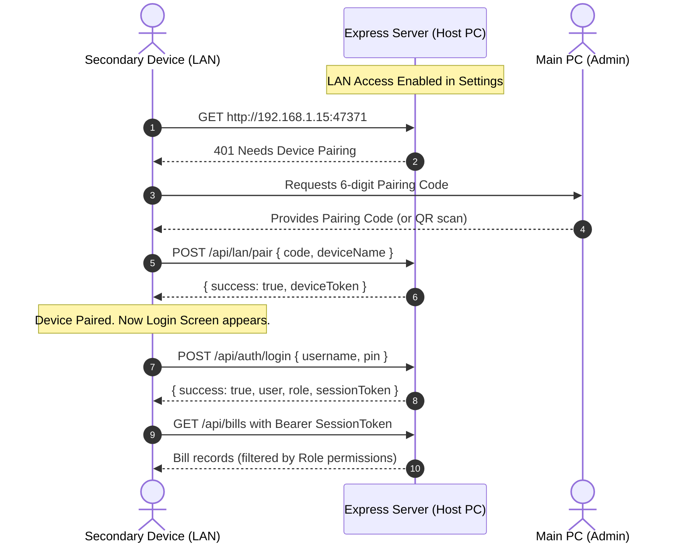

# Design Specification: Multi-User Role-Based Access Control (RBAC) & LAN Device Pairing

- **Date:** 2026-11-12
- **Author:** Antigravity / UCNPL GST Billing Software Team
- **Issue Reference:** #142, #155, #115
- **Status:** Approved by User

---

## 1. Overview & Business Context

UCNPL GST Billing Software is predominantly a desktop-first offline application. Businesses growing from single-counter operations to multi-counter retail, wholesale desks, and back-office accountants require:
1. **Multi-User Access:** Allowing different employees (Owner/Admin, Cashier/Billing Staff, Accountant, Auditor) to log in with dedicated credentials (PIN/password) and access only the features allowed by their assigned role.
2. **LAN Device Pairing:** Allowing secondary PCs, laptops, tablets, or phones connected to the same local Wi-Fi / LAN to access the billing server securely without compromising data safety or opening the server to unauthorized network probes.

---

## 2. Goals & Non-Goals

### Goals
- **Granular Permissions Matrix:** Configurable roles with checkboxes for specific actions:
  - Invoicing: create, edit, delete, apply discounts.
  - Purchases & Expenses: view, create, edit, delete.
  - Inventory: view, add, edit pricing, adjust stock.
  - Reports: view sales, P&L, client analytics, stock valuation.
  - Tax/GST: view and export GSTR-1, GSTR-3B.
  - Settings & Users: manage company profile, users, roles, devices.
- **Built-in Default Roles:** Admin (unrestricted), Cashier (sales only, no delete, no financials), Accountant (accounting, reports, GST), Viewer (read-only).
- **Fast User Switching:** Switch between users on the same terminal using a 4-digit PIN.
- **LAN Pairing Handshake:**
  - Server listens on `0.0.0.0` only when enabled in Settings.
  - Unpaired devices on the local network encounter a Pairing Screen requiring a 6-digit one-time pairing PIN or QR code scan.
  - Paired devices receive a cryptographically signed device token stored locally.
  - Main PC retains full control to inspect and revoke paired devices at any time.
- **Zero Disruption for Single Users:** Existing single-user desktop workflow remains 100% untouched until Multi-User or LAN Sharing is explicitly activated.

### Non-Goals
- Cloud database replication or internet-facing public hosting (the software remains 100% offline, local, and private).
- Multi-branch cross-city synchronization without VPN.

---

## 3. Data Models & Storage Schema

Stored under `DATA_DIR/`:

### 3.1 `data/users.json`
```json
[
  {
    "id": "u_admin",
    "username": "admin",
    "name": "Owner / Administrator",
    "pin": "1234",
    "roleId": "admin",
    "active": true,
    "createdAt": "2026-11-12T10:00:00.000Z"
  },
  {
    "id": "u_cashier",
    "username": "cashier",
    "name": "Billing Counter",
    "pin": "1111",
    "roleId": "cashier",
    "active": true,
    "createdAt": "2026-11-12T10:05:00.000Z"
  }
]
```

### 3.2 `data/roles.json`
```json
[
  {
    "id": "admin",
    "name": "Administrator",
    "description": "Full access to all modules, financial reports, settings and user management",
    "isSystem": true,
    "permissions": ["*"]
  },
  {
    "id": "cashier",
    "name": "Cashier / Billing Counter",
    "description": "Create and print invoices, quotations and sales orders. Cannot delete invoices, view financials or alter settings",
    "isSystem": true,
    "permissions": [
      "sales.create",
      "sales.edit",
      "sales.print",
      "clients.view",
      "clients.create",
      "inventory.view"
    ]
  },
  {
    "id": "accountant",
    "name": "Accountant",
    "description": "Manage sales, purchases, expenses, GSTR returns and view all business reports",
    "isSystem": true,
    "permissions": [
      "sales.view", "sales.create", "sales.edit", "sales.print",
      "purchases.manage",
      "expenses.manage",
      "reports.view",
      "gst.view",
      "clients.manage",
      "inventory.view"
    ]
  },
  {
    "id": "viewer",
    "name": "Viewer / Auditor",
    "description": "Read-only access to invoices and reports",
    "isSystem": true,
    "permissions": [
      "sales.view",
      "sales.print",
      "reports.view",
      "clients.view",
      "inventory.view"
    ]
  }
]
```

### 3.3 `data/lan_pairing.json`
```json
{
  "lanEnabled": false,
  "pairingCode": "582914",
  "pairingCodeExpires": 1794500000000,
  "authorizedDevices": [
    {
      "deviceId": "dev_abc123",
      "deviceToken": "sec_token_xyz",
      "name": "Samsung Galaxy Tab A9 (Counter 2)",
      "ip": "192.168.1.42",
      "pairedAt": "2026-11-12T10:15:00.000Z",
      "lastSeen": "2026-11-12T11:30:00.000Z"
    }
  ]
}
```

---

## 4. Architecture & Security Handshake



### 4.1 Server Network & Host Protection
1. `server.js` determines `LISTEN_HOST` dynamically:
   - When `lanEnabled` is false: binds strictly to `127.0.0.1`.
   - When `lanEnabled` is true: binds to `0.0.0.0`.
2. Host validation regex:
   - Always allows `localhost`, `127.0.0.1`, `[::1]`.
   - When `lanEnabled` is true, also allows private RFC 1918 addresses:
     `^((192\.168\.\d+\.\d+)|(10\.\d+\.\d+\.\d+)|(172\.(1[6-9]|2\d|3[01])\.\d+\.\d+))(:\d+)?$`
3. Device Token Middleware:
   - If request originates from a non-localhost IP, requires valid `x-device-token` header.
   - If missing/invalid, routes are gated behind `/api/lan/pair` and `/api/lan/status`.

### 4.2 RBAC Permission Check Middleware
- Critical operations are validated on the server:
  - `DELETE /api/bills/:id` -> requires `sales.delete` or `admin`.
  - `GET /api/reports/*` -> requires `reports.view` or `admin`.
  - `POST /api/profile` -> requires `settings.manage` or `admin`.
  - `POST /api/users/*` -> requires `users.manage` or `admin`.

---

## 5. UI / UX Design

1. **Top Header / Sidebar User Pill:**
   - Shows active user badge: `👤 Rahul (Cashier)`.
   - Clicking opens quick user switcher with PIN prompt.
2. **Login / Terminal Lock Screen:**
   - Displayed when multi-user mode is active and session is locked.
   - Fast numeric keypad for PIN entry.
3. **Settings → Users & Roles Section:**
   - **Users Tab:** Table of users with Add/Edit/Disable buttons and role assignment.
   - **Roles Tab:** Permissions matrix with interactive toggles per action.
   - **LAN & Devices Tab:**
     - Toggle: Allow connections from other computers and phones on Wi-Fi.
     - Displays network URL: `http://<Local-IP>:47371`.
     - QR Code for instant mobile camera pairing.
     - 6-digit Pairing PIN with refresh button.
     - Connected devices list with "Revoke" button.
4. **Contextual Permission Guarding in Client:**
   - Navigation links for inaccessible screens are hidden or disabled.
   - Delete buttons on invoices are hidden for users lacking `sales.delete`.

---

## 6. Verification & Test Strategy
- Unit tests in `scripts/rbac-test.mjs`:
  - User creation, PIN hashing/verification, authentication token issuance.
  - Role inheritance and granular permission checks (`hasPermission`).
  - Device pairing code generation, validation, and revocation.
  - Network IP validation for private vs public ranges.
- Full regression verification: `npm run test:unit` and `npm run build`.
